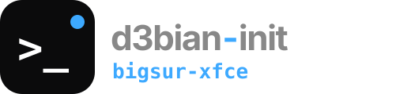
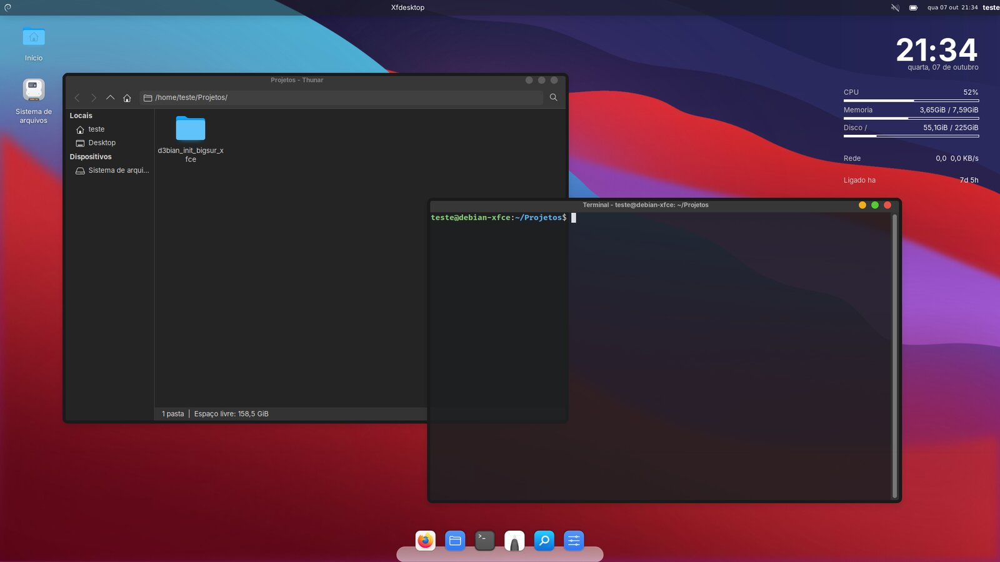
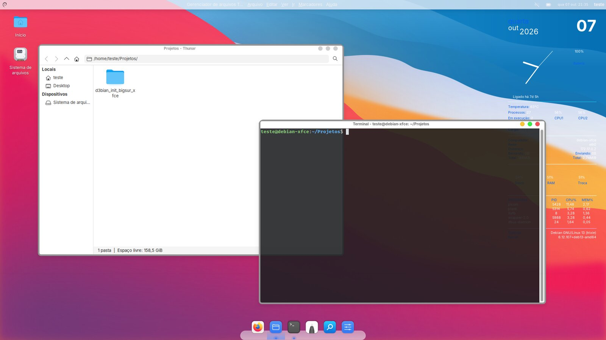
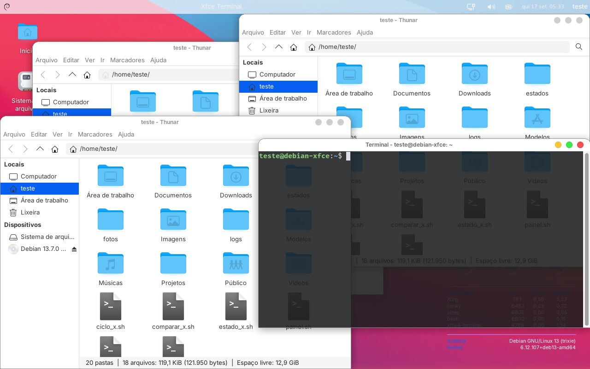
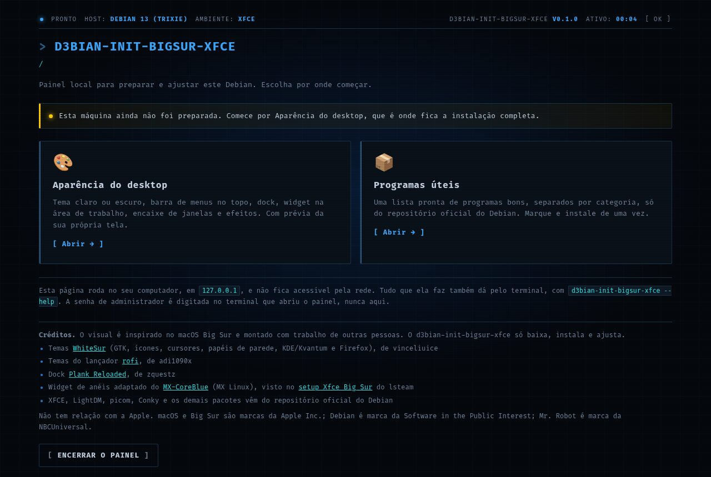
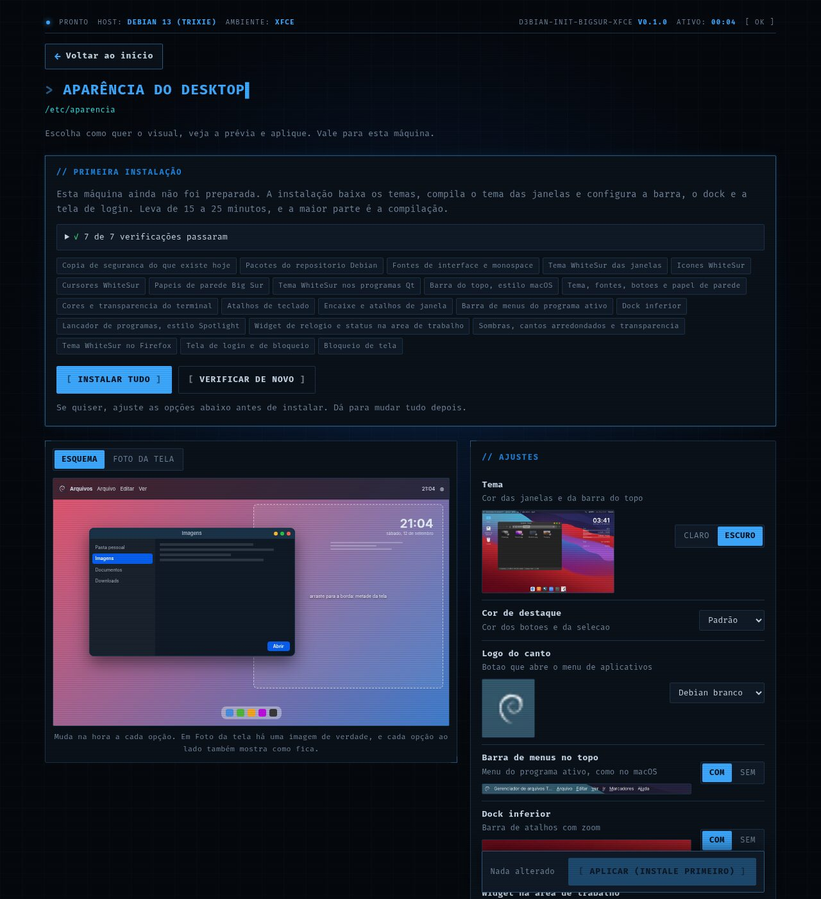
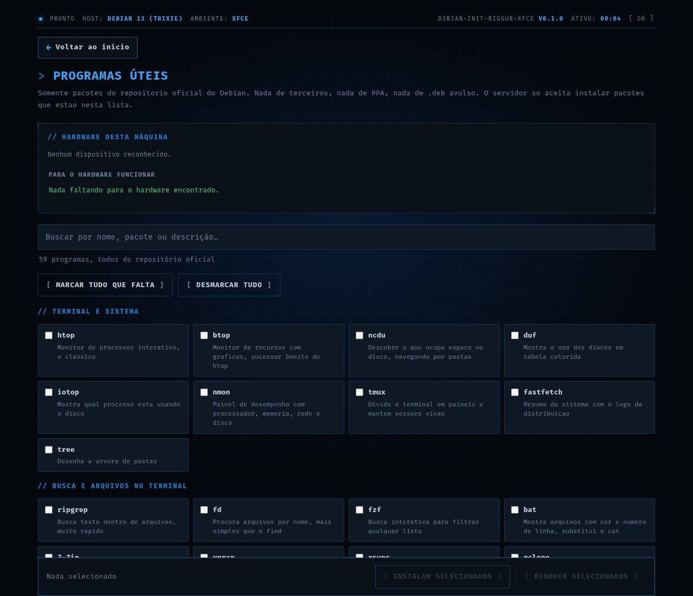
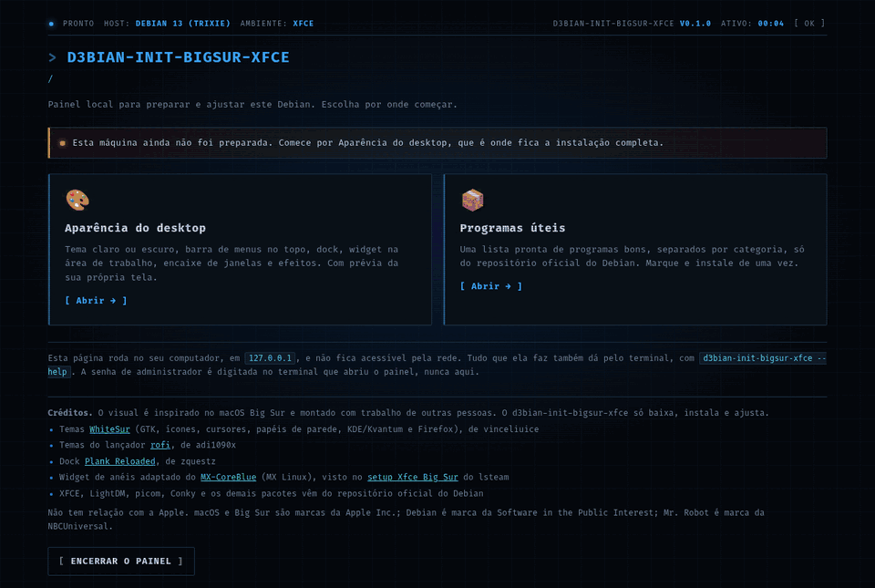

<div align="center">



**Cara de macOS Big Sur no Xfce do Debian: tema, ícones, barra no topo, dock e tela de login.**

[](docs/desenvolvimento.md)
[](docs/desenvolvimento.md)
[](docs/uso.md)
[](docs/uso.md)
[](LICENSE)

</div>

> Um painel local, aberto no navegador, para preparar e ajustar um Debian com
> Xfce, com visual inspirado no macOS Big Sur: escolha vendo, aplique, e volte
> ao que era antes quando quiser. Só Python da biblioteca padrão — nada de pip.

```sh
git clone https://git.saberdl.dev.br/d3bian-temas/bigsur-xfce.git d3bian_init_bigsur_xfce
python3 -m d3bian_init_bigsur_xfce        # pede a senha uma vez e abre o painel
```

<div align="center">
  
  <br><sub>Logo depois de instalar, com as opções padrão.</sub>
</div>

---

## O que ele faz

- **Tema WhiteSur** claro ou escuro nas janelas (GTK e Qt/Kvantum), com cor de destaque à escolha
- **Ícones, cursores e papéis de parede** WhiteSur, com galeria para escolher o papel
- **Barra no topo** estilo macOS, com logo no canto e **menu global** do programa ativo
- **Dock** inferior com zoom (Plank Reloaded) e **lançador** estilo Spotlight (rofi)
- **Widget** na área de trabalho: relógio e barras, ou anéis
- **Janelas**: sombras e cantos arredondados, bordas mais largas, encaixe e layouts no Super+Z
- **Tela de login e de bloqueio** combinando, com fundo desfocado; tema também no Firefox
- **Programas úteis** do repositório oficial, marcados e instalados de uma vez
- **Voltar ao que era antes** com um clique, inclusive removendo o que foi instalado

<!-- imagens: gerado a partir do teste num Debian 13; refazer, nao editar a mao -->
## Telas

| Com outras opções da página | Mais uma combinação de opções |
|---|---|
|  |  |

| Início | Opções | Programas úteis |
|---|---|---|
|  |  |  |

<details>
<summary><b>A instalação pela página, do começo ao resultado</b></summary>



</details>
<!-- fim imagens -->

## Documentação

| | |
|---|---|
| 🚀 [Usando](docs/uso.md) | rodar, instalação pelo painel, voltar ao que era antes |
| 🛠️ [Desenvolvimento](docs/desenvolvimento.md) | receitas, como as imagens e as miniaturas são geradas |
| ⚙️ [Núcleo](https://git.saberdl.dev.br/d3bian-temas/modelo) | o motor, o servidor e as telas comuns a toda a família |

## Família d3bian-init

Todos com o mesmo motor e o mesmo jeito de usar: um painel local, só Python da biblioteca padrão, e "voltar ao que era antes".
Os de terminal ficam em [d3bian-terminal](https://git.saberdl.dev.br/d3bian-terminal); os temas e o modelo, em [d3bian-temas](https://git.saberdl.dev.br/d3bian-temas).

| | Projeto | O que faz |
|---|---|---|
| 💻 | [terminal](https://git.saberdl.dev.br/d3bian-terminal/terminal) · [terminal-kde](https://git.saberdl.dev.br/d3bian-terminal/terminal-kde) | Fish, Oh My Posh, Nerd Font e cores (xfce4-terminal/GNOME Terminal ou Konsole) |
| 💻 | [zsh](https://git.saberdl.dev.br/d3bian-terminal/zsh) · [zsh-kde](https://git.saberdl.dev.br/d3bian-terminal/zsh-kde) | Zsh com sugestões e realce, Oh My Posh, Nerd Font e cores |
| 💻 | [bash](https://git.saberdl.dev.br/d3bian-terminal/bash) · [bash-kde](https://git.saberdl.dev.br/d3bian-terminal/bash-kde) | O bash de sempre, com sugestões e realce, Oh My Posh e Nerd Font |
| 🎨 | [bigsur-kde](https://git.saberdl.dev.br/d3bian-temas/bigsur-kde) · [mactahoe-kde](https://git.saberdl.dev.br/d3bian-temas/mactahoe-kde) | Cara de macOS (Big Sur ou Tahoe) no KDE Plasma 6 |
| 🎨 | [fluent-kde](https://git.saberdl.dev.br/d3bian-temas/fluent-kde) · [chromeos-kde](https://git.saberdl.dev.br/d3bian-temas/chromeos-kde) | Cara de Windows 11 ou de ChromeOS no KDE Plasma 6 |
| 🎨 | [catppuccin-kde](https://git.saberdl.dev.br/d3bian-temas/catppuccin-kde) · [graphite-kde](https://git.saberdl.dev.br/d3bian-temas/graphite-kde) · [layan-kde](https://git.saberdl.dev.br/d3bian-temas/layan-kde) · [orchis-kde](https://git.saberdl.dev.br/d3bian-temas/orchis-kde) | Temas Catppuccin, Graphite, Layan e Orchis no KDE Plasma 6 |
| 🪟 | **bigsur-xfce** · [bigsur-minimalista-xfce](https://git.saberdl.dev.br/d3bian-temas/bigsur-minimalista-xfce) | Cara de macOS Big Sur no Xfce, completo ou minimalista |
| 🪟 | [minimal-xfce](https://git.saberdl.dev.br/d3bian-temas/minimal-xfce) · [paleta-xfce](https://git.saberdl.dev.br/d3bian-temas/paleta-xfce) | Xfce enxuto, ou numa paleta só (Nord, Gruvbox, Everforest) |
| 🍎 | [tahoe-gnome](https://git.saberdl.dev.br/d3bian-temas/tahoe-gnome) | Cara de macOS Tahoe no GNOME 48 |
| 🧩 | [modelo](https://git.saberdl.dev.br/d3bian-temas/modelo) | O modelo de onde todos saem: crie o seu próprio d3bian-init |

Os temas Xfce (🪟) são um por conta: com outro instalado, a instalação é recusada, e `aplicar --trocar` (ou o botão no painel) volta o outro e instala este ([detalhes](docs/uso.md#um-tema-xfce-por-vez)).

## Créditos

O d3bian-init-bigsur-xfce não cria temas: baixa, instala e ajusta trabalho de outras
pessoas. Todo o mérito visual é delas.

| O quê | Projeto | Autor | Licença |
|---|---|---|---|
| Tema GTK | [WhiteSur-gtk-theme](https://github.com/vinceliuice/WhiteSur-gtk-theme) | vinceliuice | MIT |
| Ícones | [WhiteSur-icon-theme](https://github.com/vinceliuice/WhiteSur-icon-theme) | vinceliuice | GPL-3.0 |
| Cursores | [WhiteSur-cursors](https://github.com/vinceliuice/WhiteSur-cursors) | vinceliuice | GPL-3.0 |
| Papéis de parede | [WhiteSur-wallpapers](https://github.com/vinceliuice/WhiteSur-wallpapers) | vinceliuice | MIT |
| Tema Qt (Kvantum) | [WhiteSur-kde](https://github.com/vinceliuice/WhiteSur-kde) | vinceliuice | GPL-3.0 |
| Tema do Firefox | [WhiteSur-firefox-theme](https://github.com/vinceliuice/WhiteSur-firefox-theme) | vinceliuice | MIT |
| Temas do lançador | [rofi](https://github.com/adi1090x/rofi) | adi1090x | GPL-3.0 |
| Dock | [plank-reloaded](https://github.com/zquestz/plank-reloaded) | zquestz | GPL-3.0 |
| Fonte Inter | pacote `fonts-inter` do Debian | Rasmus Andersson | OFL-1.1 |
| Widget de anéis | [MX-CoreBlue](https://github.com/MX-Linux/mx-conky-data/tree/master/MX-CoreBlue), a partir do Clock Rings | MX Linux; londonali1010, despot77 e Altin | GPL-3.0 (os arquivos `conky-aneis.lua` e `conky-aneis.conf` daqui também) |
| Ideia do widget de anéis | [Xfce Big Sur setup](https://www.opencode.net/lsteam/xfce-big-sur-setup-file) | lsteam | |

As miniaturas em `recursos/web/papeis` e as prévias da página mostram os papéis
de parede do WhiteSur-wallpapers.

XFCE, LightDM, light-locker, picom, Conky, Kvantum, o menu global e os demais
pacotes vêm do repositório oficial do Debian.

## Aviso

Projeto independente, sem relação com a Apple, o Debian ou a NBCUniversal.
macOS e Big Sur são marcas da Apple Inc. Debian é marca da
Software in the Public Interest, Inc. Mr. Robot e fsociety são marcas da
NBCUniversal.

---

<div align="center">
<sub>Código sob a <a href="LICENSE">licença MIT</a>, exceto o widget de anéis (GPL-3.0) · feito para o Debian 13</sub>
</div>
